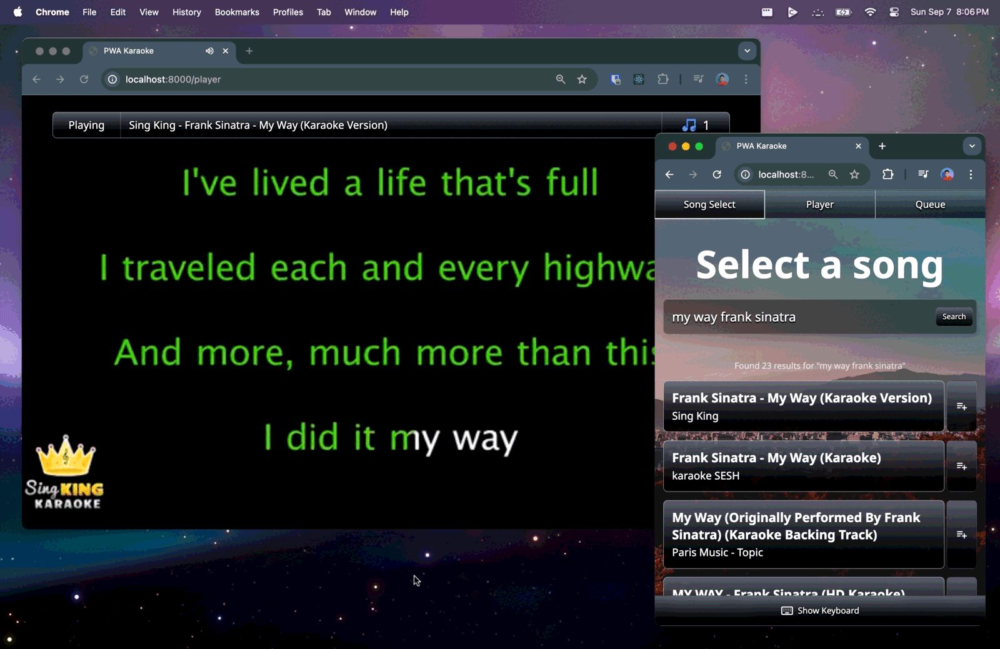

# PWA Karaoke

A web-based karaoke system. Put the video on a TV or laptop, and let everyone search for and queue songs from their phones.

> [!IMPORTANT]
> This software is intended for personal, non-commercial use only. Users are responsible for ensuring compliance with applicable copyright laws and terms of service in their jurisdiction.



*My Way, Philippines' most deadly karaoke song, playing in PWA Karaoke.*

## Contents

- [Features](#features)
- [How it works](#how-it-works)
- [Getting the code](#getting-the-code)
- [Running PWA Karaoke](#running-pwa-karaoke)
  - [Docker Compose (recommended)](#docker-compose-recommended)
  - [Docker](#docker)
  - [Without Docker](#without-docker)
- [Local development](#local-development)
- [Configuration](#configuration)
- [Troubleshooting](#troubleshooting)
- [Using PWA Karaoke](#using-pwa-karaoke)
- [Contributing](#contributing)
- [License](#license)

## Features

- Any device with a browser can be the display, and phones or tablets are the remotes. Nothing to install on either.
- Songs come from YouTube (through [yt-dlp](https://github.com/yt-dlp/yt-dlp)).
- Separate rooms, each with an optional password, so several groups can share one server.
- Several displays can play the same room in sync.
- Singer nicknames on queued songs, emoji reactions on screen, and a score at the end of every song.
- Installable as a Progressive Web App.

## How it works

PWA Karaoke has a Python backend (FastAPI) and a React frontend. The backend finds songs and resolves their video URLs with yt-dlp, keeps each room's queue, and relays commands over a WebSocket. The browser does the rest.

Each device that joins a room is one of two kinds:

- **Display**: a TV, projector, or laptop that plays the video and shows the queue.
- **Controller**: a phone or tablet that searches for songs, reserves them, and controls playback.

## Getting the code

There are no packaged releases yet. Clone the repository:

```bash
git clone https://github.com/nedpals/pwa-karaoke.git
cd pwa-karaoke
```

Or download it from GitHub with **Code** → **Download ZIP**.

## Running PWA Karaoke

The server needs at least 2 GB of RAM and 1 vCPU.

### Docker Compose (recommended)

Requires Docker with the Compose plugin. From the repository root:

```bash
./start-docker-app -d
```

This builds the image and starts two containers: the app, and a [Caddy](https://caddyserver.com/) web server in front of it on ports 80 (HTTP, set by `KARAOKE_HTTP_PORT`) and 443 (HTTPS). `start-docker-app` runs `docker compose up` with `YTDLP_CHANNEL=nightly` and passes along any arguments you give it, such as `-d` to run in the background.

Open `http://localhost`, or `http://$KARAOKE_DOMAIN` if you set `KARAOKE_DOMAIN`. This and the other settings are read from your shell or a `.env` file next to `docker-compose.yml`, and are listed under [Configuration](#configuration). With nothing set, the server answers on `localhost`.

To change the public HTTP port, set `KARAOKE_HTTP_PORT` (for example `KARAOKE_HTTP_PORT=9000` in `.env`, or `KARAOKE_HTTP_PORT=9000 ./start-docker-app -d`) and open `http://localhost:9000`. In `docker-compose.yml` this feeds the Caddy mapping `"${KARAOKE_HTTP_PORT:-80}:80"`. The first number is the port on your computer, which is the one that changes. The `:80` after the colon is the port inside the Caddy container and must stay 80, so don't edit it. HTTPS stays on port 443.

Caddy serves HTTPS automatically. For a real domain name it gets a certificate from Let's Encrypt. For `localhost` it uses its own certificate, which your browser will warn about. Caddy only answers requests for the host name in `KARAOKE_DOMAIN`, so phones must reach the server by that name, or by its LAN address as described next.

#### Phones on the same network

Phones need HTTPS to use the microphone for scoring. Without a domain name, set `KARAOKE_LAN_IP` to the computer's address on your network (for example `KARAOKE_LAN_IP=192.168.1.20` in `.env`) and restart Compose. Caddy then serves `https://<KARAOKE_LAN_IP>` with a certificate from its own certificate authority, which each phone has to trust once:

1. On the phone, open `http://<KARAOKE_LAN_IP>/ca.crt` (add `:<KARAOKE_HTTP_PORT>` if you changed it from 80) and install the certificate.
   - iOS: install the downloaded profile in Settings, then turn it on under **General** → **About** → **Certificate Trust Settings**.
   - Android: install it from **Settings** → **Security** → **Encryption & credentials** → **Install a certificate** → **CA certificate**.
2. Open the display at `https://<KARAOKE_LAN_IP>`, not `localhost`. The room's QR code uses the display's address, so phones that scan it land on the same one. If you do open the display at `localhost`, the QR code uses `KARAOKE_LAN_IP` instead.

The certificate authority is kept in the `caddy_data` volume, so phones keep trusting the server across restarts. If the computer's address changes, update `KARAOKE_LAN_IP`. Reserving the address in your router avoids this.

The app refreshes yt-dlp every time its container starts, so a restart is enough to pick up the latest version. The nightly channel picks up YouTube fixes before a stable release does. To use stable releases instead, run Compose directly:

```bash
YTDLP_CHANNEL=stable docker compose up -d
```

To stop everything, run `docker compose down`.

### Docker

To run the app without Caddy, for example behind a reverse proxy you already have:

```bash
docker build -t pwa-karaoke .
docker run -d -p 8000:8000 --name pwa-karaoke pwa-karaoke
```

Open `http://localhost:8000`.

Pass settings with `-e NAME=value` (see [Configuration](#configuration)). Unlike Compose, this does not refresh yt-dlp when the container starts. Add `-e YTDLP_AUTO_UPDATE=1` to `docker run` to turn that on. To build the image with a nightly yt-dlp, add `--build-arg YTDLP_CHANNEL=nightly` to `docker build`.

### Without Docker

Install the [prerequisites](#prerequisites), then build the frontend into the backend and start the server:

```bash
cd frontend
npm ci
npm run build:prod   # writes the built app to backend/static

cd ../backend
uv sync --no-dev
uv run python main.py
```

Open `http://localhost:8000`.

## Local development

For working on the code, run the backend and the Vite dev server in two terminals, both starting from the repository root. The dev server reloads the frontend as you edit.

### Prerequisites

- [uv](https://docs.astral.sh/uv/), which installs the right Python version (3.12) for you
- Node.js 20 or newer

Install uv once.

macOS / Linux:

```bash
curl -LsSf https://astral.sh/uv/install.sh | sh
```

Windows (PowerShell):

```powershell
powershell -ExecutionPolicy ByPass -c "irm https://astral.sh/uv/install.ps1 | iex"
```

If you already have Python, `pip install uv` works too. Open a new terminal afterwards so `uv` is on your PATH.

If you cannot get uv or Node working, open the repository in the dev container (`.devcontainer/`) with VS Code or GitHub Codespaces. It installs both for you.

### Terminal 1: backend

```bash
cd backend
uv sync
uv run python main.py
```

`uv sync` creates `backend/.venv` and installs the locked dependencies, including yt-dlp. There is no virtual environment to activate. The backend listens on `http://localhost:8000`. Its settings are environment variables, listed under [Configuration](#configuration).

To update yt-dlp later, run `uv lock --upgrade-package yt-dlp && uv sync`. If you need a nightly build, see [Songs won't play](#songs-wont-play).

### Terminal 2: frontend

```bash
cd frontend
npm ci
npm run dev
```

### Open the app

- On your computer: `http://localhost:5173`
- On a phone on the same Wi-Fi: `http://<your-LAN-IP>:5173`. Vite prints the exact address as `Network:` when it starts.

The dev server forwards API and WebSocket requests to the backend on `http://localhost:8000`, so phones need nothing else. To use a backend running somewhere else, set `VITE_BACKEND_URL`, for example `VITE_BACKEND_URL=http://192.168.1.20:8000 npm run dev`.

Over plain `http://<LAN-IP>:5173` phones cannot use their microphones, so scores are generated instead. See [Microphone scoring doesn't work](#microphone-scoring-doesnt-work).

For the contribution workflow, tests, and a tour of the code, see [CONTRIBUTING.md](CONTRIBUTING.md), [backend/README.md](backend/README.md), and [frontend/README.md](frontend/README.md).

## Configuration

The backend reads these environment variables. With Docker Compose, set them in your shell or in a `.env` file next to `docker-compose.yml`.

| Variable | Default | Purpose |
| --- | --- | --- |
| `KARAOKE_DOMAIN` | `localhost` | Host name Caddy serves and gets a certificate for. Also added to the backend's allowed CORS origins. |
| `KARAOKE_LAN_IP` | `127.0.0.1` | The computer's LAN address, which Caddy also serves over HTTPS. The backend reports it on `/heartbeat`. See [Phones on the same network](#phones-on-the-same-network). |
| `PORT` | `8000` | Port the backend listens on. |
| `ROOM_IDLE_TTL_SECONDS` | `3600` | How long a room with nobody connected is kept before it is deleted. `0` keeps rooms until the server restarts. |
| `KARAOKE_HTTP_PORT` | `80` | Compose only. Host port for plain HTTP access through Caddy. |
| `PROXY_SERVER` | | Proxy for YouTube requests, such as `http://proxy:8080`. |
| `PROXY_USERNAME`, `PROXY_PASSWORD` | | Credentials for `PROXY_SERVER`. |
| `KARAOKE_SOURCES` | all | Comma-separated song sources to enable. `youtube` is the only one today. |
| `SEARCH_TIMEOUT_SECONDS` | `20` | Time limit for one search. |
| `YTDLP_TIMEOUT_SECONDS` | `45` | Time limit for one yt-dlp call. |
| `YTDLP_RUNTIME` | `deno` | JavaScript runtime yt-dlp uses for YouTube, as `RUNTIME[:PATH]` (for example `node` or `node:/usr/bin/node`). |
| `YTDLP_PLAYER_CLIENT` | | Comma-separated YouTube player clients. Empty lets yt-dlp choose. |
| `YTDLP_EXTRA_ARGS` | | Extra yt-dlp command-line flags, shell quoted. |
| `YTDLP_BINARY` | `yt-dlp` | Name or path of the yt-dlp executable. |

> **Renamed settings.** `DOMAIN` is now `KARAOKE_DOMAIN` and `LAN_IP` is now `KARAOKE_LAN_IP`. The old names are no longer read, so rename them in your shell or `.env`, or Caddy will quietly fall back to `localhost`.

These apply only to the Docker image:

| Variable | Default | Purpose |
| --- | --- | --- |
| `YTDLP_CHANNEL` | `stable` | `stable` or `nightly` yt-dlp builds. `start-docker-app` sets `nightly`. |
| `YTDLP_AUTO_UPDATE` | `1` with Compose, `0` with `docker run` | Set to `1` to refresh yt-dlp every time the container starts. |

## Troubleshooting

For API and WebSocket problems, see the Troubleshooting section of [backend/README.md](backend/README.md#troubleshooting).

### A phone can't open the app

- The phone must be on the same Wi-Fi network as the computer running the server.
- Use the address Vite prints as `Network:` (development) or the computer's LAN address (Docker, port 80 by default or `KARAOKE_HTTP_PORT`).
- With Docker Compose, Caddy only answers on the LAN address if `KARAOKE_LAN_IP` is set to it. See [Phones on the same network](#phones-on-the-same-network).
- A firewall on the computer may be blocking the port (5173 for the dev server). Allow it, or temporarily turn the firewall off to test.

### "Room not found"

Rooms are kept in memory, so restarting the server removes them. A room is also deleted once nobody has been connected to it for an hour (see `ROOM_IDLE_TTL_SECONDS` under [Configuration](#configuration)). Create the room again from the home screen.

### Search returns nothing

- The server needs internet access to reach YouTube.
- YouTube may be blocking requests from your network. Try a [proxy](#configuration) or the nightly yt-dlp in [Songs won't play](#songs-wont-play).
- Open `/health` on the server (for example `http://localhost:8000/health`) to see whether the song source is working. It returns 503 when no source can play videos.

### `yt-dlp binary not found`

The backend can't find yt-dlp. Run `uv sync` in `backend/`, then start the server with `uv run python main.py` so it uses that environment. If yt-dlp lives elsewhere, set `YTDLP_BINARY` to its path.

### Songs won't play

If searches work but songs won't play, and the backend logs show "Sign in to confirm you're not a bot" or "Requested format is not available", YouTube has probably changed something that the stable yt-dlp release does not handle yet.

With Docker Compose, use `./start-docker-app`, which installs the latest nightly build each time the app starts. Restart it to pick up a newer one.

Without Docker, install the latest nightly into the backend's environment and start the server with `--no-sync`:

```bash
cd backend
uv pip install --upgrade "yt-dlp[default,deno]>=0.0.0.dev0"
uv run --no-sync python main.py
```

Keep using `--no-sync` every time you start the server. Plain `uv run` silently puts the locked stable release back. Check which version you have with `uv run --no-sync yt-dlp --version`: a nightly ends in a long build number, such as `2026.10.10.233141`. To go back to stable, run `uv sync`.

### Microphone scoring doesn't work

Browsers only allow the microphone on HTTPS pages (and on `localhost`). A phone that opens the app over plain `http://`, such as the dev server's LAN address, falls back to generated scores. This is expected. To score with the microphone, serve the app over HTTPS: through Caddy with a real `KARAOKE_DOMAIN`, or with `KARAOKE_LAN_IP` set (see [Phones on the same network](#phones-on-the-same-network)).

### A display plays no sound

Browsers block audio until the page has been clicked. A new display shows a **Sound Check** screen. Click **Allow Sound** on it before songs start.

## Using PWA Karaoke

### Joining a room

Rooms let groups run separate karaoke sessions on the same server. The home screen has one room field, filled in with a generated name that you can keep or replace.

Press **Join Room**. What happens next depends on the room name:

- **The room does not exist yet.** It is created when you enter, and you can give it a **Room Password**.
- **The room exists and has no password.** You enter straight away.
- **The room exists and has a password.** You are asked for it before you can enter.

In the same dialog, choose what this device becomes:

- **Enter as Display**: plays the video and shows the queue. You can open several displays in one room and they stay in sync. Not offered on small screens.
- **Enter as Controller**: searches for songs and controls playback.

While a display is waiting for songs, it shows a QR code. Scanning it with a phone is the quickest way to join as a controller.

### Nicknames

A controller asks **Who Is Singing?** before it joins. That nickname is attached to every song reserved from it: it appears in the controller's **Reserved** tab and next to the song on the display, in the now-playing banner and on the Up Next card. Everyone can see whose turn is coming.

The phone remembers the nickname and fills it in the next time it joins a room. Change it when the phone changes hands. Nicknames can be up to 14 characters, which is what fits beside a song title on a phone.

Displays are never asked for a name. Each one picks its own, such as `Stage 42`, and shows it in its corner status strip, which helps when several screens share a room.

### Controller tabs

- **Search**: find songs and reserve them.
- **Player**: play, pause, skip, volume, autoplay, and reactions.
- **Reserved**: the queue. Move a song to the front or remove it.

Every controller in a room has full control. Any phone can skip, remove, or clear any song, not only the ones it reserved. This is intended.

### Autoplay

By default, reserved songs play one after another: when a song ends, the display starts the next one.

Turning off **Autoplay** in the **Player** tab stops that. When a song ends, the display holds and shows what is up next until someone presses **Next**. If nothing is reserved, the display returns to its idle screen. The setting applies to the whole room, so every controller and display in it agrees, and the display shows an `Autoplay Off` marker while it is off.

**Next** always skips to the next reserved song, whatever the Autoplay setting.

### Reactions

The **Player** tab has a row of reactions (👏 🔥 ❤️ 😂 ⭐ 👎). Tapping one floats it across every display in the room.

### Scoring

Every song gets a score when it ends, including songs that are skipped. Songs that played for less than five seconds are not scored. The display spins through digits until the score lands, shows it for a moment, and moves on.

A controller starts with a **Mic Check**, much as a display starts with a Sound Check. If you allow it, the phone scores your singing through its microphone. The audio stays on the phone and only the score is sent. Only the phone that reserved the current song listens.

If you decline, the browser refuses, or the app is open over plain `http`, the score is generated instead. Both kinds of score fall in the same range.

## Contributing

Contributions are welcome. See [CONTRIBUTING.md](CONTRIBUTING.md) for the workflow, how to run the checks, and a tour of the code. Please read the [Code of Conduct](CODE_OF_CONDUCT.md) before participating.

## License

This project is licensed under the MIT License. See the [LICENSE](LICENSE) file for details.

---

**Disclaimer:** This software is provided "as is" without warranty of any kind. Use at your own risk and ensure compliance with all applicable laws and terms of service.

© 2025 Ned Palacios
